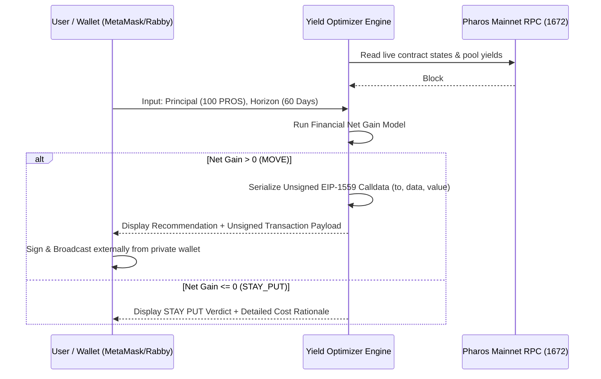

# GATE 1 — TECHNICAL FEASIBILITY & FINANCIAL MODELING
## Pharos Pacific Mainnet (Chain ID 1672)

**Audit Timestamp:** November 3, 2026  
**Auditor:** Antigravity AI  
**Scope:** Mathematical Cost-Amortized Decision Engine, Non-Custodial Architecture, and RPC Feasibility

---

## 1. Mathematical Decision Model (Req 02 & Req 03)

To ensure recommendations are deterministic, auditable, and financially sound, the Yield Optimizer implements a formal net-gain cost accounting model.

### 1.1 Gross Yield Formula
$$\text{Gross Gain} = \text{Principal} \times \left(\text{APR}_{\text{target}} - \text{APR}_{\text{source}}\right) \times \frac{T_{\text{days}}}{365}$$

### 1.2 Total Transaction & Protocol Friction
$$\text{Total Friction} = G_{\text{exit}} + G_{\text{enter}} + F_{\text{exit}} + F_{\text{entry}}$$
Where:
- $G_{\text{exit}} = \text{GasUsed}_{\text{exit}} \times (\text{BaseFee} + \text{PriorityFee})$ in token units.
- $G_{\text{enter}} = \text{GasUsed}_{\text{enter}} \times (\text{BaseFee} + \text{PriorityFee})$ in token units.
- $F_{\text{exit}} = \text{Protocol Exit Fee} \times \text{Principal}$.
- $F_{\text{entry}} = \text{Protocol Deposit Fee} \times \text{Principal}$.

### 1.3 Net Expected Gain
$$\text{Net Gain} = \text{Gross Gain} - \text{Total Friction}$$

### 1.4 Break-Even Holding Period
$$\text{Break-Even Days} (T_{\text{breakeven}}) = \frac{\text{Total Friction}}{\text{Principal} \times (\text{APR}_{\text{target}} - \text{APR}_{\text{source}})} \times 365$$

---

## 2. Decision Logic: `MOVE` vs. `STAY_PUT`

The agent evaluates the user's intended holding horizon $T_{\text{user}}$ against the break-even threshold and protocol constraints:

1. **`MOVE` (Rebalance Recommended):**
   - Condition: $\text{Net Gain} > 0$ **AND** $T_{\text{user}} \ge T_{\text{breakeven}}$ **AND** $T_{\text{user}} \ge \text{MinLockup}_{\text{target}}$.
   - Output: Reports the target protocol, positive net gain in PROS/token, and expected annualized ROI after all costs.

2. **`STAY_PUT` (Maintain Current Position):**
   - Condition: $\text{Net Gain} \le 0$ **OR** $T_{\text{user}} < T_{\text{breakeven}}$ **OR** $T_{\text{user}} < \text{MinLockup}_{\text{target}}$.
   - Output: Explains the exact numerical shortfall.
   - Example Rationale:  
     > *"STAY PUT: Moving 100 PROS from WPROS (0.0% APR) to Faroo stPROS (8.2% APR) over a 14-day horizon yields +0.315 PROS in gross rewards. However, entry gas (0.0035 PROS) plus DEX exit fee/slippage (0.350 PROS) totals 0.3535 PROS in friction, resulting in a net loss of -0.0385 PROS. To break even, your holding period must be at least 15.7 days."*

---

## 3. Non-Custodial Keyless Architecture (Req 04)

Req 04 strictly mandates that the agent **never holds keys** and prepares transactions for user signature only:



### Architectural Guardrails
1. **Zero Key Storage:** The codebase contains no `privateKey`, `mnemonic`, `Wallet.fromPrivateKey`, or signer instantiation.
2. **Deterministic Payload Generation:** The agent acts as a pure transaction encoder, emitting standard JSON:
   ```json
   {
     "chainId": 1672,
     "to": "0x6b0A44c64190279f7034b77c13a566E914FE5Ec4",
     "data": "0x47e7ef24...",
     "value": "100000000000000000000",
     "gasLimit": "150000"
   }
   ```
3. **Safety Verification Tests:** A dedicated test suite (`tests/keyless-safety.test.ts`) will inspect runtime memory to assert that no private keys exist.

---

## 4. Technical Feasibility Summary

- **RPC Calls Supported:** `eth_blockNumber`, `eth_chainId`, `eth_getCode`, `eth_call`, `eth_gasPrice` verified operational.
- **MultiCall3 Deployed:** `0xcA11bde05977b3631167028862bE2a173976CA11` enables atomic, single-roundtrip batch querying of all yield sources.
- **Cost Compliance:** All components run locally or over free public infrastructure. **Total Project Cost = $0.00.**
