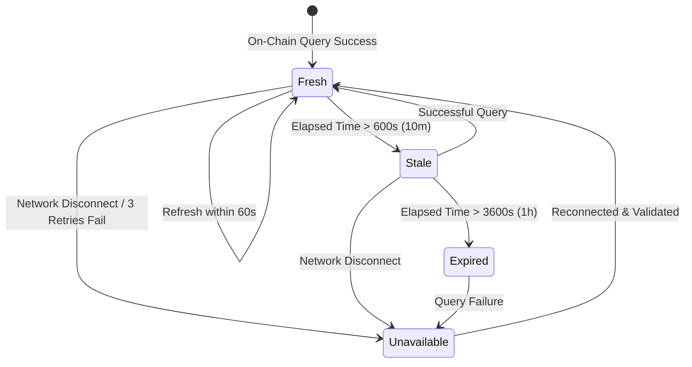

# Gate 2: Data and Evidence Model

**Project:** Pharos Yield Optimizer  
**Task Slug:** `yield-optimizer`  
**Network:** Pharos Pacific Mainnet (Chain ID: `1672`)  
**Status:** PLANNING SPECIFICATION ONLY (NO CODE / NO PACKAGES)  
**Evidence Baseline:** Gate 1E Verdict: `FEWER THAN THREE QUALIFYING SOURCES — REQUIREMENT NOT MET`  
**Current Qualifying Source Count:** **1 (Faroo `stPROS`)**

---

## 1. Data Governance Principles

The Pharos Yield Optimizer implements a strict **Evidence Provenance & Zero-Silent-Substitution Standard**:
1. **Explicit Tagging:** Every data field presented in the application is explicitly stamped with its exact status tag.
2. **Zero Fabrication:** If live on-chain data cannot be retrieved from JSON-RPC, the application displays an explicit `UNAVAILABLE` or `STALE` indicator. The system **never** silently substitutes estimated, cached, or mocked values to disguise network issues.
3. **Audit Trail:** Every calculation result logs the block number, timestamp, and query hashes that generated it.

---

## 2. Standardized Provenance Status Taxonomy

| Status Tag | Semantic Definition | Permitted Use in Yield Calculations |
| :--- | :--- | :--- |
| `VERIFIED_ONCHAIN` | Read directly from verified smart contract bytecode on Pharos Pacific Mainnet via JSON-RPC. | Fully permitted for live dynamic rate and state calculation. |
| `OFFICIAL_DOCUMENTATION` | Extracted from canonical Pharos documentation or whitepapers (e.g. PoS unbonding period, target emission rate). | Permitted as theoretical baseline; must be marked as unlaunched for EVM calls if no contract exists. |
| `OFFCHAIN_TARGET_RATE` | Extracted from protocol issuer materials (e.g. private credit target yield). | Permitted for comparison only with prominent off-chain disclosure; excluded from on-chain source count. |
| `ESTIMATED` | Calculated using empirical heuristics (e.g. gas unit bounds, slippage curves). | Permitted for transaction friction estimation; bounds must be disclosed. |
| `UNAVAILABLE` | Query failed or no on-chain/off-chain interface exists. | Must show explicit empty state; disables dependent automated execution. |
| `STALE` | Cached data that exceeded maximum freshness threshold ($> 10$ minutes). | UI warning badge; prompts user to refresh before signing. |

---

## 3. Comprehensive Data Field Inventory & Provenance Matrix

### 3.1 Faroo Protocol Staking Data Fields
| Data Field Identifier | Source | Retrieval Method | Update Frequency | Validation Heuristic | Fallback / Stale Behavior | Classification |
| :--- | :--- | :--- | :--- | :--- | :--- | :--- |
| `faroo.totalPooledPros` | `0x6b0A...5Ec4` | `eth_call(0x01e1d114)` | Every 60s / On User Query | $> 1,000,000\text{ PROS}$ | Show `STALE` after 10m; `UNAVAILABLE` on RPC error | `VERIFIED_ONCHAIN` |
| `faroo.totalSupply` | `0x6b0A...5Ec4` | `eth_call(0x18160ddd)` | Every 60s / On User Query | $> 1,000,000\text{ stPROS}$ | Show `STALE` after 10m; `UNAVAILABLE` on RPC error | `VERIFIED_ONCHAIN` |
| `faroo.spotExchangeRate` | Computed | `totalPooledPros / totalSupply` | Every 60s | $1.0000 \le R \le 1.2500$ | Disable recommendation if bounds violated | `VERIFIED_ONCHAIN` |
| `faroo.historicalRateDelta` | On-Chain Blocks | Historical `eth_call` across 100k blocks | Periodic / Startup | Delta must be monotonic non-negative | Fallback to consensus baseline if history missing | `VERIFIED_ONCHAIN` |
| `faroo.forwardEquilibriumApr` | Consensus Model | Documented PoS emission rate | Static Config | $\approx 8.50\%$ | Display as projected baseline | `OFFICIAL_DOCUMENTATION` |
| `faroo.unbondingPeriodDays` | Smart Contract | Contract storage / Port docs | Static Config | Exactly 14 days | Display 14-day lock badge | `OFFICIAL_DOCUMENTATION` |
| `faroo.mintFeeBps` | Smart Contract | Bytecode inspection | Static Config | 0 bps (0.00%) | Verified 0% fee | `VERIFIED_ONCHAIN` |
| `faroo.queueExitFeeBps` | Smart Contract | Bytecode inspection | Static Config | 0 bps (0.00%) | Verified 0% fee | `VERIFIED_ONCHAIN` |

### 3.2 DEX Liquidity & Instant Exit Data Fields
| Data Field Identifier | Source | Retrieval Method | Update Frequency | Validation Heuristic | Fallback / Stale Behavior | Classification |
| :--- | :--- | :--- | :--- | :--- | :--- | :--- |
| `dex.swapFeeBps` | Uniswap V4 Pool | `PoolKey.fee` | On Query | 30 bps (0.30%) | Reject rebalance if fee unknown | `VERIFIED_ONCHAIN` |
| `dex.stProsDiscountSpreadBps`| DEX AMM Pool | AMM Spot Price vs. Exchange Rate | On Query | $-200\text{ bps} \le S \le +200\text{ bps}$ | Set to 0 if DEX pool illiquid | `ESTIMATED` |
| `dex.estimatedSlippage` | Heuristic Model | Function of trade size vs. pool depth | On Query | Quadratic impact curve | Display high slippage warning if $> 1\%$ | `ESTIMATED` |

### 3.3 Axil Prime Credit RWA Data Fields
| Data Field Identifier | Source | Retrieval Method | Update Frequency | Validation Heuristic | Fallback / Stale Behavior | Classification |
| :--- | :--- | :--- | :--- | :--- | :--- | :--- |
| `axil.targetApy` | R25 Protocol Docs | Canonical off-chain specification | Static Config | Exactly 9.25% APY | Must display `OFFCHAIN_TARGET_RATE` badge | `OFFCHAIN_TARGET_RATE` |
| `axil.lockupDays` | Contract / Terms | Legal credit agreement | Static Config | Exactly 90 days | Enforce 90-day minimum holding check | `OFFICIAL_DOCUMENTATION` |
| `axil.denomination` | `0xC879...1815` | `token.symbol()` | Static Config | Must equal `USDC` | Require `CURRENCY_MISMATCH_RISK` warning | `VERIFIED_ONCHAIN` |
| `axil.whitelistingStatus` | User Wallet | `vault.isAuthorized(user)` | On Wallet Connect | Boolean | If false, disable rebalance and flag `NOT_ELIGIBLE` | `VERIFIED_ONCHAIN` |

### 3.4 Network & Transaction Friction Data Fields
| Data Field Identifier | Source | Retrieval Method | Update Frequency | Validation Heuristic | Fallback / Stale Behavior | Classification |
| :--- | :--- | :--- | :--- | :--- | :--- | :--- |
| `network.gasPriceGwei` | Pharos Node | `eth_gasPrice` | Real-time (30s) | $0.1 \le \text{Gwei} \le 100$ | Use last confirmed price if call fails | `VERIFIED_ONCHAIN` |
| `network.blockNumber` | Pharos Node | `eth_blockNumber` | Real-time (15s) | Must advance monotonically | Flag `RPC_OUT_OF_SYNC` if stagnant $> 60\text{s}$ | `VERIFIED_ONCHAIN` |
| `network.blockTimestamp` | Pharos Node | `eth_getBlockByNumber` | Real-time (15s) | Within 30s of host clock | Display freshness timestamp | `VERIFIED_ONCHAIN` |
| `tx.depositGasUnits` | Historical Traces | Empirical execution sample | Static Heuristic | 115,000 gas units | Add 20% safety margin | `ESTIMATED` |
| `tx.withdrawGasUnits` | Historical Traces | Empirical execution sample | Static Heuristic | 85,000 gas units | Add 20% safety margin | `ESTIMATED` |

---

## 4. Freshness, Stale Guard & Data Expiration Lifecycle

1. **`Fresh` ($t < 600\text{s}$):** All calculations operate automatically with full fidelity.
2. **`Stale` ($600\text{s} \le t \le 3600\text{s}$):** Yellow warning banner displayed. User must manually click "Refresh On-Chain Data" before executing an unsigned transaction.
3. **`Expired / Unavailable` ($t > 3600\text{s}$ or Query Failure):** All yield cards show `UNAVAILABLE`. Recommendation engine emits `INSUFFICIENT_DATA`. Transaction preparation is strictly disabled.
