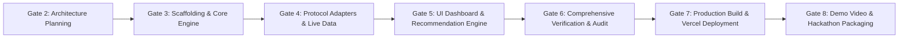

# Gate 2: Sequenced Implementation Roadmap

**Project:** Pharos Yield Optimizer  
**Task Slug:** `yield-optimizer`  
**Network:** Pharos Pacific Mainnet (Chain ID: `1672`)  
**Status:** PLANNING SPECIFICATION ONLY (NO CODE / NO PACKAGES)  
**Evidence Baseline:** Gate 1E Verdict: `FEWER THAN THREE QUALIFYING SOURCES — REQUIREMENT NOT MET`  
**Current Qualifying Source Count:** **1 (Faroo `stPROS`)**

---

## 1. Roadmap Principles & Strict Gating Rules

Future implementation of the Pharos Yield Optimizer will follow a strict, gated, evidence-driven engineering process. 

### Inviolable Rules:
- **No Work Without Explicit Authorization:** Each gate must be authorized individually before execution starts.
- **$0-First Philosophy:** Use free public RPC (`https://rpc.pharos.xyz`), free open-source frameworks (Next.js, Tailwind, viem), and free deployment infrastructure (Vercel). Zero spend ($0.00).
- **Zero Fabrication:** Real on-chain data only.
- **Task 14 Preservation:** `skills/pharos-portfolio-assistant` must remain 100% untouched and clean throughout all gates.

---

## 2. Sequenced Implementation Gates

---

### Gate 3: Workspace Scaffolding & Pure TypeScript Core Engine
- **Objective:** Initialize clean Next.js/React workspace in `skills/pharos-yield-optimizer`, set up TypeScript configuration, and implement the pure mathematical yield and friction engine.
- **Modules / Files to Create:**
  - `skills/pharos-yield-optimizer/package.json`
  - `skills/pharos-yield-optimizer/tsconfig.json`
  - `skills/pharos-yield-optimizer/src/types/index.ts`
  - `skills/pharos-yield-optimizer/src/engine/yieldMath.ts`
  - `skills/pharos-yield-optimizer/src/engine/frictionModel.ts`
  - `skills/pharos-yield-optimizer/src/engine/recommendationEngine.ts`
  - `skills/pharos-yield-optimizer/test/unit/engine.test.ts`
- **Dependencies:** Standard dev dependencies (`typescript`, `vitest` / `jest`).
- **Risks:** Type misalignments; numerical precision overflow with large wei values.
- **Test Criteria:** 100% test coverage on pure calculation functions: break-even periods, net alpha, lockup eligibility checks, and "STAY PUT" threshold logic.
- **Evidence Required:** Unit test runner logs passing all test cases.
- **Approval Boundary:** Stop and await user authorization before proceeding to Gate 4.

---

### Gate 4: Pharos RPC Client & Protocol Adapters
- **Objective:** Implement the read-only Pharos JSON-RPC client, multi-call helpers, and live protocol adapters for Faroo `stPROS`, DEX exit, Axil RWA, and native PROS baseline.
- **Modules / Files to Create:**
  - `skills/pharos-yield-optimizer/src/config/constants.ts` (Chain ID 1672, Contract addresses)
  - `skills/pharos-yield-optimizer/src/rpc/pharosClient.ts` (Direct RPC with timeout/retry)
  - `skills/pharos-yield-optimizer/src/adapters/farooAdapter.ts`
  - `skills/pharos-yield-optimizer/src/adapters/dexExitAdapter.ts`
  - `skills/pharos-yield-optimizer/src/adapters/axilAdapter.ts`
  - `skills/pharos-yield-optimizer/src/adapters/baselineAdapter.ts`
  - `skills/pharos-yield-optimizer/test/integration/live_rpc.test.ts`
- **Dependencies:** `viem` (or native lightweight fetch).
- **Risks:** RPC rate-limiting or latency spikes on `https://rpc.pharos.xyz`.
- **Test Criteria:** Live RPC test queries return valid spot exchange rate from Faroo (`0x6b0A...5Ec4`), valid block height, and gas price within sanity bounds.
- **Evidence Required:** Integration test report logging real block numbers and query hex outputs.
- **Approval Boundary:** Stop and await user authorization before proceeding to Gate 5.

---

### Gate 5: UI Dashboard & Non-Custodial Transaction Reviewer
- **Objective:** Construct the 8-screen dashboard UI, parameter controls, live strategy comparison cards, break-even visualizer, and non-custodial transaction preparation modal.
- **Modules / Files to Create:**
  - `skills/pharos-yield-optimizer/src/components/Header.tsx` (Ecosystem reality chip)
  - `skills/pharos-yield-optimizer/src/components/PortfolioOverview.tsx`
  - `skills/pharos-yield-optimizer/src/components/ParameterControls.tsx`
  - `skills/pharos-yield-optimizer/src/components/StrategyCards.tsx`
  - `skills/pharos-yield-optimizer/src/components/RecommendationBanner.tsx`
  - `skills/pharos-yield-optimizer/src/components/BreakEvenChart.tsx`
  - `skills/pharos-yield-optimizer/src/components/TxReviewModal.tsx`
  - `skills/pharos-yield-optimizer/src/components/AuditDrawer.tsx`
  - `skills/pharos-yield-optimizer/src/pages/index.tsx`
- **Dependencies:** React, Tailwind CSS, Lucide icons.
- **Risks:** UI responsiveness across mobile/desktop; complex state synchronization.
- **Test Criteria:** Component testing verifying dynamic recalculation on slider change; unsigned tx simulation preflight executes without error.
- **Evidence Required:** UI component build success and screenshot/HTML render verification.
- **Approval Boundary:** Stop and await user authorization before proceeding to Gate 6.

---

### Gate 6: Comprehensive Verification & Audit
- **Objective:** Conduct end-to-end testing across all user scenarios, edge cases (zero balance, small balance, high slippage, RPC timeout), and verify compliance with official Arena criteria.
- **Modules / Files to Create:**
  - `skills/pharos-yield-optimizer/docs/GATE6_VERIFICATION_REPORT.md`
  - `skills/pharos-yield-optimizer/docs/GATE6_COMPLIANCE_AUDIT.md`
- **Test Criteria:** All unit, integration, and E2E tests pass. Zero mock data confirmed. Non-custodial security assertion confirmed.
- **Evidence Required:** Full test suite run log; security audit sign-off.
- **Approval Boundary:** Stop and await user authorization before proceeding to Gate 7.

---

### Gate 7: Production Build, GitHub Repository & Vercel Deployment
- **Objective:** Initialize Git in the task repository, push to GitHub (`JimmyOgb/pharos-yield-optimizer`), and deploy to production on Vercel with zero environment errors.
- **Modules / Files to Create:**
  - `skills/pharos-yield-optimizer/.gitignore`
  - `skills/pharos-yield-optimizer/README.md` (Full documentation with architecture and audit links)
  - `skills/pharos-yield-optimizer/docs/GATE7_DEPLOYMENT_REPORT.md`
- **Test Criteria:** Production URL returns `HTTP 200 OK` with sub-1.5s First Contentful Paint.
- **Evidence Required:** Live public Vercel URL and GitHub repository link.
- **Approval Boundary:** Stop and await user authorization before proceeding to Gate 8.

---

### Gate 8: Walkthrough Video Production & Hackathon Submission Packaging
- **Objective:** Record a professional walkthrough demo video (+50 Arena bonus points), generate professional synchronized voiceover, and compile final submission dossier.
- **Deliverables:**
  - Timestamped demo narration script.
  - Narrated video demo.
  - Final Arena submission payload (proof link, repo link, video link).
- **Approval Boundary:** Final user review and manual submission to Pharos Agent Arena.
