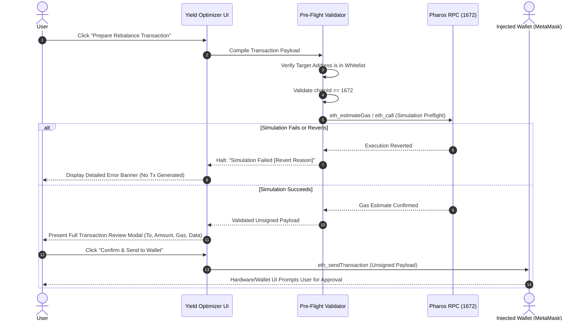

# Gate 2: Security & Non-Custodial Architecture Design

**Project:** Pharos Yield Optimizer  
**Task Slug:** `yield-optimizer`  
**Network:** Pharos Pacific Mainnet (Chain ID: `1672`)  
**Status:** PLANNING SPECIFICATION ONLY (NO CODE / NO PACKAGES)  
**Evidence Baseline:** Gate 1E Verdict: `FEWER THAN THREE QUALIFYING SOURCES — REQUIREMENT NOT MET`  
**Current Qualifying Source Count:** **1 (Faroo `stPROS`)**

---

## 1. Security Philosophy & Non-Custodial Manifesto

Requirement 04 of the Pharos Agent Arena Task 15 establishes an inviolable constraint:
> *"If executing: prepares transactions for user signature only. The agent never holds keys."*

The Pharos Yield Optimizer operates on a strict **zero-custody, zero-autonomous-signing, zero-secret-exposure** architecture. The agent acts exclusively as an analytical advisor and deterministic transaction compiler.

---

## 2. Inviolable Security Invariants

1. **Zero Private-Key Ingestion:** The codebase contains zero inputs, APIs, environment variables, or memory structures for private keys, seed phrases, or keystores.
2. **Zero Autonomous Signing:** The agent cannot initiate or broadcast transactions. Every transaction requires explicit user interaction, review, and cryptographic signature in an external EIP-1193 wallet (MetaMask, Rabby, etc.).
3. **Strict Chain-ID Hardcoding:** All transaction payloads enforce `chainId: 1672` (`0x688`). Any mismatch with the user's active wallet network halts execution immediately.
4. **Verified Target Whitelist:** Transactions can only target verified contract addresses compiled into the audited registry:
   - Faroo Protocol: `0x6b0A44c64190279f7034b77c13a566E914FE5Ec4`
   - Canonical WPROS: `0x52C46eD4e803a647000e5aA6145B1c110996D872`
   - Pharos DEX: `0xD681534E2741BEdf60fc5C7A2De109f6baB5aF0A`
   - Axil Vault: `0xD0428799FbC35557834d33121BA4472692c8908a`

---

## 3. Transaction Preparation & User Review Pipeline



---

## 4. Threat Model & Safeguards

### 4.1 Malicious RPC or MITM Manipulation
- **Threat:** A compromised or spoofed RPC node returns manipulated exchange rates ($R \gg 1.0$) to trick the optimizer into recommending bad rebalances.
- **Safeguards:**
  - **Rate Boundary Checks:** The engine asserts $1.0000 \le R \le 1.2500$. Any rate outside this interval raises an `IRREGULAR_RATE_SPIKE` error.
  - **Trailing Rate Volatility Clamps:** Forward APR projections are bounded to documented consensus emission limits ($\le 12.00\%$), preventing flash-loan or single-block spoofing from skewing decisions.
  - **Multi-Call Parity:** In production, critical exchange rates can be checked against both `eth_call` contract state and AMM spot ratios.

### 4.2 Front-Running & Sandwich Attacks (DEX Exit Route)
- **Threat:** When executing an instant DEX swap from `stPROS` to `WPROS`, MEV searchers sandwich the transaction.
- **Safeguards:**
  - **Strict Slippage Limit:** Transaction preparation enforces a maximum slippage tolerance (e.g. $0.50\%$).
  - **Minimum Output Parameter (`minAmountOut`):** Calculated on-chain before submission. Transactions that return less than `minAmountOut` automatically revert in the DEX contract.

### 4.3 Phishing & Hostile Address Injection
- **Threat:** Malicious actor modifies browser DOM to swap the deposit contract address to an attacker wallet.
- **Safeguards:**
  - **Immutable Address Constants:** Target addresses are stored as frozen, immutable TypeScript constants.
  - **Checksum Verification:** All addresses are verified against EIP-55 checksum standards.
  - **Target Verification in UI:** The transaction review modal displays the destination contract label and verified explorer link (`https://pharoscan.xyz/address/...`).

### 4.4 Untrusted External Protocol Data
- **Threat:** Unverified third-party token contracts or malicious ERC-20 implementations cause unexpected state changes.
- **Safeguards:**
  - The optimizer strictly interacts with vetted, verified core contracts.
  - No dynamic loading of arbitrary user-submitted contract addresses.

---

## 5. Transaction Review Screen Specification

Before any transaction payload is passed to the wallet, the user is presented with a non-bypassable **Transaction Review Modal**:

```
+-------------------------------------------------------------------+
|               TRANSACTION PREFLIGHT REVIEW (CHAIN: 1672)         |
+-------------------------------------------------------------------+
| Action:              Stake Native PROS to Faroo Liquid Staking   |
| Target Contract:     Faroo Protocol (0x6b0A...5Ec4) [VERIFIED]   |
| Function:            submit(address _referral = 0x0)              |
| Value to Send:       1,000.00 PROS                                |
| Estimated Gas:       115,000 units (~0.00014 PROS @ 1.25 Gwei)    |
| Maximum Slippage:    0.00% (Native Protocol Mint)                |
| Protocol Lockup:     14-Day Queue on Exit (or Instant via DEX)    |
| Simulation Status:   SUCCESSFUL PREFLIGHT (0 Revert Warnings)     |
+-------------------------------------------------------------------+
| [X] I understand that this action is non-custodial and I am       |
|     reviewing the transaction parameters in my external wallet.  |
|                                                                   |
| [ CANCEL ]                           [ SEND TO WALLET TO SIGN ]   |
+-------------------------------------------------------------------+
```
