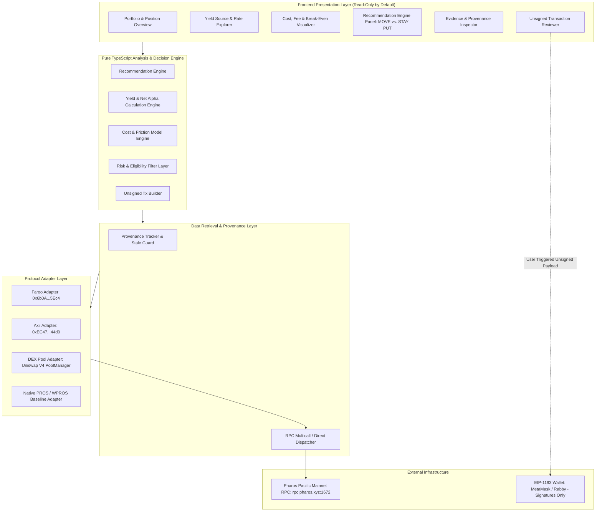
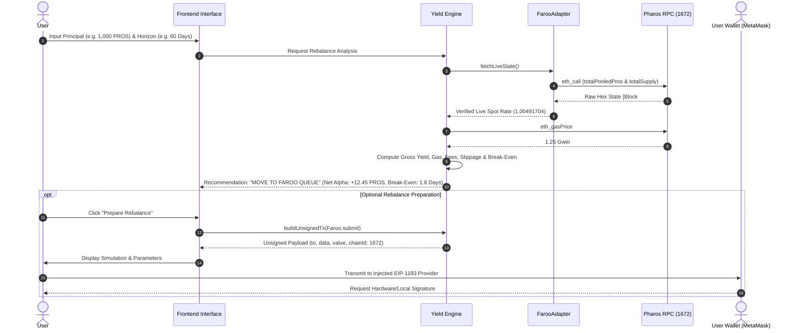

# Gate 2: System Architecture Design

**Project:** Pharos Yield Optimizer  
**Task Slug:** `yield-optimizer`  
**Network:** Pharos Pacific Mainnet (Chain ID: `1672`)  
**Status:** PLANNING SPECIFICATION ONLY (NO CODE / NO PACKAGES)  
**Evidence Baseline:** Gate 1E Verdict: `FEWER THAN THREE QUALIFYING SOURCES — REQUIREMENT NOT MET`  
**Current Qualifying Source Count:** **1 (Faroo `stPROS`)**

---

## 1. Architectural Baseline & Guiding Principles

The Pharos Yield Optimizer is designed as an evidence-grounded, non-custodial portfolio analysis and rebalance preparation engine.

### Strict Architectural Tenets:
1. **Truth-First Accounting:** Zero phantom protocols, zero mock rates, and zero simulated validator tiers.
2. **Transparent Evidence Provenance:** Every displayed metric must carry its exact data source label (`VERIFIED_ONCHAIN`, `OFFCHAIN_TARGET_RATE`, `EXECUTION_ALTERNATIVE`, or `BASELINE_ONLY`).
3. **One Qualifying Source Constraint:** The system explicitly acknowledges that Pharos Pacific Mainnet currently hosts only **one** verified on-chain liquid staking yield protocol (Faroo `stPROS`). Other candidates represent an execution alternative (Faroo Instant DEX Exit), an off-chain targeted RWA vault (Axil `APC3M`), or a zero-yield benchmark (Native PROS / WPROS).
4. **Non-Custodial Boundary:** The application never requests, accesses, stores, or transmits private keys. Any potential execution action is strictly restricted to generating unsigned transaction payloads for user review and signature via an external EIP-1193 wallet.

---

## 2. High-Level Architecture Diagram



---

## 3. Subsystem Breakdown

### 3.1 Frontend Presentation Layer
- **Role:** Renders live on-chain balances, calculates net yield gains, visualizes break-even timelines, and displays deterministic recommendations.
- **Default State:** 100% read-only. Operates fully without requiring a connected wallet by allowing public address lookup or simulated position inputs.
- **Provenance Badging:** Each strategy card displays an immutable tag indicating its official classification.

### 3.2 Protocol Adapter Layer (Modular Interface)
To guarantee that newly launched protocols (such as native PoS delegation in the upcoming Anvita Mate release) can be integrated without architectural refactoring, all protocols implement a unified `IYieldProtocolAdapter` interface:

```typescript
// Architectural interface specification (planning definition)
interface IYieldProtocolAdapter {
  readonly id: string;
  readonly name: string;
  readonly assetSymbol: string;
  readonly classification: 'VERIFIED_ONCHAIN' | 'EXECUTION_ALTERNATIVE' | 'OFFCHAIN_TARGET_RATE' | 'BASELINE_ONLY';
  readonly contractAddress?: string;
  
  fetchLiveState(rpcProvider: IRpcProvider): Promise<ProtocolState>;
  calculateGrossYield(state: ProtocolState, horizonDays: number): YieldProjection;
  calculateFriction(state: ProtocolState, principal: bigint, isInstant: boolean): FrictionBreakdown;
  getUnbondingConstraint(): UnbondingTerms;
}
```

#### Implemented Adapters:
1. **`FarooAdapter`:**
   - Targets Faroo `stPROS` (`0x6b0A44c64190279f7034b77c13a566E914FE5Ec4`).
   - Fetches `totalPooledPros()` (`0x01e1d114`) and `totalSupply()` (`0x18160ddd`).
   - Extracts spot exchange rate $R = \text{totalPooledPros} / \text{totalSupply}$.
   - Models the 14-day unbonding queue and 0% protocol exit fee.
2. **`FarooDexExitAdapter`:**
   - Pairs `stPROS` with `WPROS` on Pharos DEX PoolManager (`0xD681...`).
   - Models 0.30% swap fee and dynamic pool slippage.
   - Tagged strictly as `EXECUTION_ALTERNATIVE`.
3. **`AxilCreditAdapter`:**
   - Targets `APC3M` share token (`0xEC47...`) and vault (`0xD042...`).
   - Denominated in USDC (`0xC879...`).
   - Tagged strictly as `OFFCHAIN_TARGET_RATE` with 90-day institutional lockup and AML requirement.
4. **`NativeProsBaselineAdapter`:**
   - Evaluates unstaked PROS / WPROS (`0x52C4...`).
   - Tagged as `BASELINE_ONLY` with 0.00% APY.

### 3.3 Yield Calculation Engine
- **Role:** Computes realized historical exchange rate accrual vs. projected forward return.
- **Separation of Concerns:** Distinguishes between the empirical short-term bootstrapping delta ($30.37\%$ annualized over 29.2 hours) and the normalized consensus equilibrium rate ($\sim 8.50\%$).
- **Net Alpha:** Calculates $\text{Net Alpha} = \text{Projected Gross Yield} - \text{Total Rebalance Costs}$.

### 3.4 Cost & Friction Model Engine
- **Gas Costs:** Integrates live `eth_gasPrice` and historical execution gas bounds:
  - Faroo `submit()` deposit: $\approx 115,000$ gas.
  - Faroo `requestWithdraw()`: $\approx 85,000$ gas.
  - DEX `swap()`: $\approx 145,000$ gas.
  - ERC-20 `approve()`: $\approx 45,000$ gas.
- **Entry / Exit Protocol Fees:** Evaluates protocol fees (0% on Faroo queue, 0.30% on DEX swap).
- **Slippage Model:** Dynamic constant-product / stableswap slippage curve based on trade size vs. pool liquidity.
- **Time Value of Liquidity:** Explicit penalty or opportunity cost for 14-day and 90-day locks.

### 3.5 Recommendation Engine
- **Deterministic Rule Base:** Evaluates net financial benefit over user-specified investment horizon $T$.
- **Outputs:**
  - `MOVE`: Projected net gain $> 0$ after all transaction friction, gas, and horizon constraints.
  - `STAY_PUT`: Total friction exceeds gross yield over horizon $T$, or user already holds optimal position.
  - `INSUFFICIENT_DATA`: Critical on-chain parameters cannot be retrieved or RPC is degraded.
  - `NOT_ELIGIBLE`: User lacks whitelisting (e.g. Axil KYC) or position fails minimum sizing.
  - `RISK_TOO_HIGH`: Asset volatility or currency divergence exceeds risk profile.

### 3.6 Non-Custodial Transaction Preparation Layer
- **Execution Protocol:** Operates strictly on a "Prepare-Review-Sign" flow.
- Generates transparent, human-readable EIP-155 transaction payloads:
  - `to`: Target protocol contract address.
  - `data`: Exact ABI-encoded function call.
  - `value`: Native PROS value (if payable).
  - `gasLimit`: Gas estimate with conservative safety buffer.
  - `chainId`: Strictly locked to `1672` (Pharos Pacific Mainnet).

---

## 4. Component Interaction & Data Flow



---

## 5. Security & Isolation Boundaries

| Subsystem | Execution Permission | State Access | Network Access |
| :--- | :--- | :--- | :--- |
| **Presentation Layer** | Read-Only UI | Component state | Browser DOM only |
| **Yield Engine** | Pure functional math | Read-only input | No network calls |
| **Adapter Layer** | Read-only queries | On-chain state | `https://rpc.pharos.xyz` |
| **Tx Builder** | Unsigned serialization | Read-only ABI | No network calls |
| **User Wallet** | User-controlled signing | Private keys | User-controlled RPC |

This architecture ensures zero custodial liability, complete auditability, and total alignment with the Pharos Agent Arena requirements.
