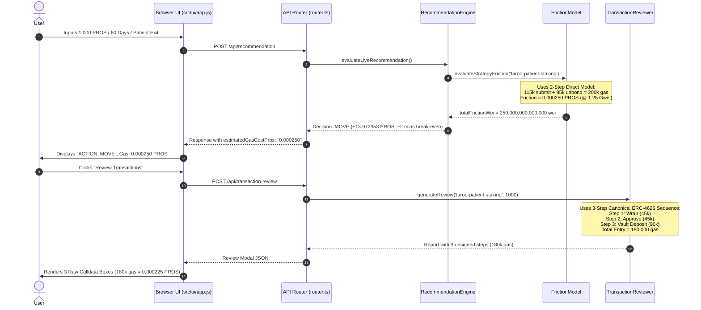

# GATE 7A.4 — AUDIT 1: EXECUTION PATH TRACE & METHOD INVENTORY
## End-to-End Tracing from User Scenario Input to Wallet Review Calldata

**Project:** Pharos Yield Optimizer  
**Network:** Pharos Pacific Mainnet (`Chain ID: 1672` / `0x688`, Native Asset: `PROS`)  
**Workspace:** `C:\Users\NO GO NO\PharosBuild\skills\pharos-yield-optimizer`  
**Date:** November 4, 2026  
**Auditor:** Antigravity AI  
**Mode:** READ-ONLY Source & Calldata Trace (No Source Edits)  

---

## 1. Executive Summary

This audit establishes the exact execution paths implemented across the Pharos Yield Optimizer by inspecting concrete function definitions, EVM method selectors, target contract addresses, parameter encodings, and UI consumers.

### Key Finding:
- **Two different entry abstractions exist in the codebase**:
  1. **The Recommendation Engine (`frictionModel.ts`)** models a single-step entry `FAROO_DEPOSIT_SUBMIT` (115,000 gas) + exit `FAROO_REQUEST_WITHDRAW` (85,000 gas) = **200,000 gas units**.
  2. **The Transaction Reviewer (`transactionReviewer.ts`)** prepares a 3-step ERC-4626 sequence for immediate wallet execution: Wrap (45,000 gas) + Approve (45,000 gas) + Deposit (90,000 gas) = **180,000 entry gas units**.
- **Exit Operations:**
  - Neither the recommendation engine nor the transaction reviewer prepares raw unsigned calldata for exit/unbonding at the time of entry.
  - The recommendation engine charges the exit queue gas (85,000 gas) in advance during scenario evaluation.
  - The transaction reviewer only reviews the immediate entry sequence, annotating the exit delay and queue conditions as a text disclosure.

---

## 2. Inventory of Supported Protocol Methods

### 2.1 Deposit Methods Supported in Source Code

#### Method 1: Canonical WPROS Wrap Deposit
- **Target Contract:** `0x52C46eD4e803a647000e5aA6145B1c110996D872` (`CANONICAL_WPROS`)
- **Method Name:** `deposit()`
- **EVM Method Selector:** `0xd0e30db0`
- **Call Type:** Native payable transaction (`msg.value = amountWei`).
- **Parameters:** None (value transfer only).
- **Calldata Generated:** `0xd0e30db0`
- **Gas Limit Allocated:** `45,000` (`0xafc8`)
- **Location:** [`src/reviewer/transactionReviewer.ts`](file:///C:/Users/NO%20GO%20NO/PharosBuild/skills/pharos-yield-optimizer/src/reviewer/transactionReviewer.ts#L136-L159).
- **Consumed By:** Step 1 of Reviewer Modal in [`src/ui/app.js`](file:///C:/Users/NO%20GO%20NO/PharosBuild/skills/pharos-yield-optimizer/src/ui/app.js#L359-L373).

#### Method 2: ERC-20 WPROS Spender Approval
- **Target Contract:** `0x52C46eD4e803a647000e5aA6145B1c110996D872` (`CANONICAL_WPROS`)
- **Method Name:** `approve(address spender, uint256 amount)`
- **EVM Method Selector:** `0x095ea7b3`
- **Parameters:**
  - `spender` (address): `0x6b0A44c64190279f7034b77c13a566E914FE5Ec4` (Faroo stPROS proxy).
  - `amount` (uint256): Exact principal in wei (`amountWei`).
- **Calldata Generated:** `0x095ea7b3` + 32-byte zero-padded spender address + 32-byte hex-encoded amount.
- **Gas Limit Allocated:** `45,000` (`0xafc8`)
- **Location:** [`src/reviewer/transactionReviewer.ts`](file:///C:/Users/NO%20GO%20NO/PharosBuild/skills/pharos-yield-optimizer/src/reviewer/transactionReviewer.ts#L160-L196).
- **Consumed By:** Step 2 of Reviewer Modal in [`src/ui/app.js`](file:///C:/Users/NO%20GO%20NO/PharosBuild/skills/pharos-yield-optimizer/src/ui/app.js#L359-L373).

#### Method 3: ERC-4626 Vault Share Minting Deposit
- **Target Contract:** `0x6b0A44c64190279f7034b77c13a566E914FE5Ec4` (`FAROO_STPROS`)
- **Method Name:** `deposit(uint256 assets, address receiver)`
- **EVM Method Selector:** `0x6e553f65`
- **Parameters:**
  - `assets` (uint256): Exact WPROS deposit in wei (`amountWei`).
  - `receiver` (address): User's recipient wallet address.
- **Calldata Generated:** `0x6e553f65` + 32-byte hex-encoded assets + 32-byte zero-padded receiver address.
- **Gas Limit Allocated:** `90,000` (`0x15f90`)
- **Location:** [`src/reviewer/transactionReviewer.ts`](file:///C:/Users/NO%20GO%20NO/PharosBuild/skills/pharos-yield-optimizer/src/reviewer/transactionReviewer.ts#L197-L234).
- **Consumed By:** Step 3 of Reviewer Modal in [`src/ui/app.js`](file:///C:/Users/NO%20GO%20NO/PharosBuild/skills/pharos-yield-optimizer/src/ui/app.js#L359-L373).

#### Method 4: Theoretical Direct Native Deposit (`submit()`)
- **Target Contract:** Faroo protocol helper or native entry interface.
- **Method Name:** Generic `submit()` or direct native deposit.
- **EVM Method Selector:** Not implemented in `transactionReviewer.ts`.
- **Gas Limit Allocated:** `115,000` in [`src/engine/frictionModel.ts`](file:///C:/Users/NO%20GO%20NO/PharosBuild/skills/pharos-yield-optimizer/src/engine/frictionModel.ts#L18).
- **Status:** **Theoretical model benchmark**. Used exclusively in `frictionModel.ts` for financial simulation; no calldata is generated.

---

### 2.2 Exit / Unbonding Methods Supported in Source Code

#### Exit Path A: Protocol Unbonding Queue (`requestWithdraw`)
- **Target Contract:** `0x6b0A44c64190279f7034b77c13a566E914FE5Ec4` (`FAROO_STPROS`)
- **Method Concept:** ERC-7540 / Faroo queue order submission (`requestWithdraw`).
- **Gas Limit Allocated:** `85,000` in `frictionModel.ts`.
- **Exit Fee:** `0.00%` verified on-chain.
- **Lockup Delay:** 14 days (1-day protocol parameter + up to 14-day epoch queue settlement).
- **Implementation Status:** Charged in `frictionModel.ts` and disclosed in `router.ts` line 377. Calldata generation is deferred until the user reaches the end of their investment horizon.

#### Exit Path B: Secondary Market AMM Swap (Instant Exit)
- **Target Contract:** Pharos Uniswap V4 PoolManager (`CANONICAL_CONTRACTS.DEX_POOL_MANAGER`).
- **Method Concept:** `swapExactTokensForTokens` (stPROS $\to$ WPROS).
- **Gas Limit Allocated:** `145,000` in `frictionModel.ts`.
- **Exit Fee:** `0.30%` swap fee + `0.10%` retail slippage (`4.00 PROS` per 1,000 PROS principal).
- **Lockup Delay:** `0 days` (instant execution).
- **Implementation Status:** Charged in `frictionModel.ts` when `requiresInstantLiquidity = true`.

---

## 3. End-to-End Execution Trace

---

## 4. Path Compatibility & Relationship Between Entry and Exit

1. **Belonging to Same Protocol:**
   - Both the 3-step ERC-4626 entry and the 14-day queue exit operate on the same canonical proxy address: `0x6b0A44c64190279f7034b77c13a566E914FE5Ec4`.
   - Minting stPROS via `deposit(uint256,address)` issues canonical stPROS shares that are eligible for the protocol unbonding queue via `requestWithdraw`.
   - Therefore, the entry and exit methods **belong to the exact same on-chain protocol**.
2. **UI Method Consumption:**
   - The UI dashboard directly displays the recommendation's estimated friction ($0.000250\text{ PROS}$) based on the 200,000 gas model.
   - When the user opens the reviewer modal, the UI presents the 3-step calldata based on the 180,000 gas entry sequence.
3. **Path Assumption Mismatch:**
   - The recommendation calculation in `frictionModel.ts` assumes a **115,000 gas entry** (`FAROO_DEPOSIT_SUBMIT`).
   - The transaction reviewer generates calldata for a **180,000 gas entry** (`Wrap 45k + Approve 45k + Deposit 90k`).
   - This represents an internal model mismatch of $65,000\text{ gas units}$ between the recommendation engine's simulation and the transaction reviewer's calldata.
