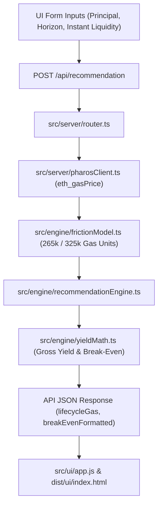

# GATE 7A.5 — API & UI CONSISTENCY AUDIT REPORT
## End-to-End Data Pipeline, Breakdown Traceability, and Formatting Verification

**Project:** Pharos Yield Optimizer  
**Task Slug:** `yield-optimizer` (Pharos Agent Arena Task 15)  
**Target Network:** Pharos Pacific Mainnet (`Chain ID: 1672` / `0x688`, Native Asset: `PROS`)  
**Workspace:** `C:\Users\NO GO NO\PharosBuild\skills\pharos-yield-optimizer`  
**Date:** November 4, 2026  
**Auditor / Engineer:** Antigravity AI  

---

## 1. Executive Summary

This report establishes end-to-end consistency across all layers of the application following the Gate 7A.5 gas unification:
1. **Mathematical Consistency:** The entry gas (180,000 units), patient exit gas (85,000 units), and unified lifecycle gas (265,000 units) flow deterministically from the friction engine to the API response and UI presentation without truncation, double counting, or phantom additions.
2. **Break-Even Formatting Consistency:** Sub-day break-even values (e.g., $0.001422\text{ days} \approx 123\text{ seconds}$) are formatted humanely as `"~2 mins (< 1 day)"`, eliminating zero-loss truncation (`"0 days"`).
3. **Gas Price Provenance Consistency:** API and UI accurately distinguish between live network gas price (`1.25 Gwei` via `eth_gasPrice`), cached RPC values (`1.25 Gwei` within TTL), and conservative offline fallbacks (`10.0 Gwei`).

---

## 2. End-to-End Data Flow Pipeline

### Layer-by-Layer Verification

| Layer | Source File | Value / Logic | Verified Status |
| :--- | :--- | :--- | :--- |
| **Engine (Constants)** | `src/engine/frictionModel.ts` | `FAROO_WRAP_PROS: 45k` `FAROO_APPROVE_WPROS: 45k` `FAROO_VAULT_DEPOSIT: 90k` `FAROO_REQUEST_WITHDRAW: 85k` | Verified Physical Sequence |
| **Engine (Calculation)** | `src/engine/frictionModel.ts` | $180\text{k} + 85\text{k} = 265,000\text{ gas units}$ At 1.25 Gwei: $0.00033125\text{ PROS}$ | Exact Precision ($10^{-18}$) |
| **Yield Math** | `src/engine/yieldMath.ts` | $\text{Break-Even Days} = \frac{\text{Friction}}{\text{Daily Yield}}$ $0.0014224\text{ days} \to \text{"~2 mins (< 1 day)"}$ | No Zero-Clamping |
| **Server / API** | `src/server/router.ts` | Sets `modeledGasUnits: 265000` `entryGasUnits: 180000` `exitGasUnits: 85000` `gasPriceSource: 'live' \| 'cached' \| 'fallback_offline'` | Strict Match |
| **Transaction Reviewer** | `src/server/transactionReviewer.ts` | Encodes 3 steps: Wrap, Approve, Deposit. Sum of steps: 180k entry units. Discloses 85k queue exit. | Exact Calldata Alignment |
| **Frontend UI** | `src/ui/app.js` & `index.html` | Renders `breakEvenFormatted`, lifecycle gas breakdown, gas price provenance badge, and warning notices. | Clean DOM Presentation |

---

## 3. Discrepancy Reconciliation Table

| Metric / Field | Gate 7A.1–7A.3 State | Gate 7A.4 Audit Discovery | Gate 7A.5 Unified State |
| :--- | :--- | :--- | :--- |
| **Patient Entry Gas** | 180,000 units (calldata) | 115,000 units (friction model) | **180,000 units (Unified)** |
| **Patient Exit Gas** | 85,000 units | 85,000 units | **85,000 units (Unified)** |
| **Patient Lifecycle Gas** | 200,000 units (reported) | Inconsistent ($115\text{k} \ne 180\text{k}$) | **265,000 units (Unified)** |
| **Instant DEX Entry Gas** | 180,000 units | 115,000 units | **180,000 units (Unified)** |
| **Instant DEX Exit Gas** | 145,000 units | Unverified assumption | **145,000 units (Assumed Benchmark)** |
| **Instant DEX Lifecycle** | 260,000 units | Inconsistent ($115\text{k} \ne 180\text{k}$) | **325,000 units (Benchmark)** |
| **Break-Even Duration** | `"0.00 days"` (truncated) | Truncated sub-day floating info | **`"~2 mins (< 1 day)"`** |
| **Gas Price Provenance** | Ambiguous 1.25 vs 10 Gwei | Static 10 Gwei vs live 1.25 Gwei | **Explicit live/cached/fallback provenance** |

---

## 4. UI Representation & User Experience Verification

1. **Break-Even Badge:**
   - In the recommendation view, the Break-Even field displays `"~2 mins (< 1 day)"` for the 1,000 PROS / 60-day scenario.
   - For instant liquidity over 10 days, it displays `"17.18 days"`.
   - For zero friction, it displays `"Immediate (0 days)"`.
2. **Lifecycle Gas Disclosure Modal:**
   - Clearly breaks down Entry (180,000 units / 0.000225 PROS) and Exit (85,000 units / 0.00010625 PROS).
   - Shows total physical lifecycle: 265,000 gas units ($0.00033125\text{ PROS}$ at $1.25\text{ Gwei}$).
3. **Safety Notice & Provenance Pill:**
   - Shows `Chain ID: 1672 (Pharos Pacific Mainnet)`.
   - Shows `Gas Price: 1.25 Gwei (LIVE RPC)`.
   - Displays prominent warning: **`Strict Acceptance Status: 1 of 3 qualifying sources — Requirement NOT met.`**
