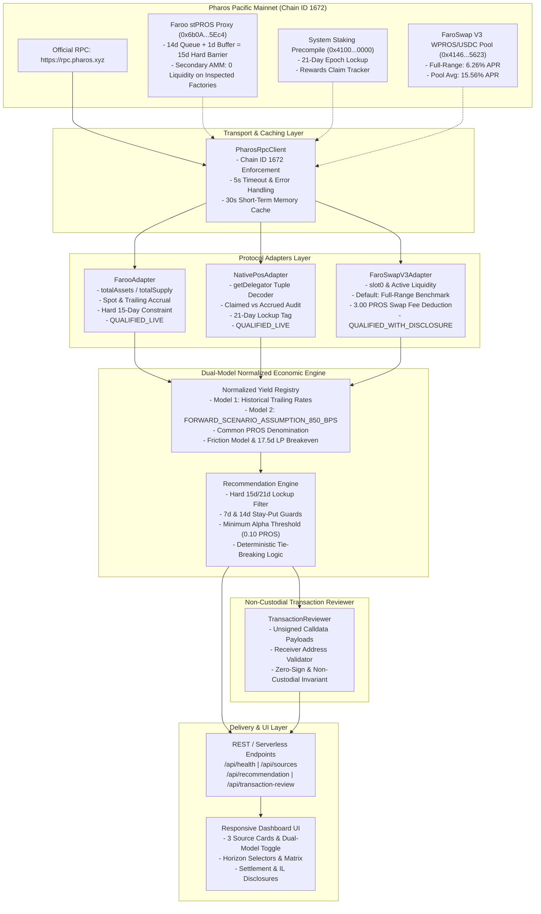
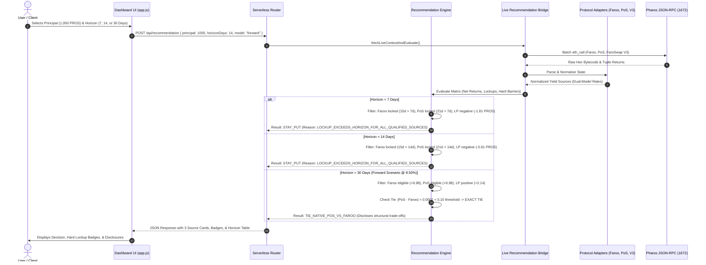

# PHAROS TASK 15 — GATE 9: ARCHITECTURE AND RISK REGISTER (REVISED GATE 9.2)

**Project:** Pharos Yield Optimizer  
**Workspace:** `C:\Users\NO GO NO\PharosBuild\skills\pharos-yield-optimizer`  
**Network:** Pharos Pacific Mainnet — Chain ID `1672` (`0x688`), RPC `https://rpc.pharos.xyz`  
**Accepted Baseline Commit:** `53bbf0fc23bde1ef3bdd97f0c153eca8e5cc27ec`  
**Revision Date:** November 7, 2026 (Gate 9.2 Economic Re-Alignment)  
**Status:** Comprehensive Architectural Blueprint & Risk Mitigation Matrix  

---

## 1. System Architecture & Component Diagram

The revised three-source architecture isolates transport, protocol adaptation, dual-model economic projection, transaction review, and user interface into decoupled layers:

---

## 2. End-to-End Data Flow Sequence

---

## 3. Comprehensive Risk Register (Updated Gate 9.2)

| Risk ID | Category | Risk Description | Severity | Likelihood | Architectural Mitigation Strategy |
| :--- | :--- | :--- | :---: | :---: | :--- |
| **R-01** | **Financial** | **Historical Trailing Rate Misrepresentation:** Users mistake trailing APR (26.14% Faroo / 29.98% PoS) for guaranteed forward APY. | **High** | High | Clear UI dual-model toggle strictly separating *Realized Historical Trailing Observations* from *Conservative Forward Baseline (`FORWARD_SCENARIO_ASSUMPTION_850_BPS`)*. |
| **R-02** | **Financial** | **Uniswap V3 Full-Range vs Pool Average Discrepancy:** Full-range position earns 6.26% APR, whereas pool TVL average is 15.56% due to concentrated liquidity distribution. | **High** | High | Adopt **6.26% Standard Full-Range Benchmark** as default. Expose 15.56% solely as an aggregate *Pool Volume Indicator* with explanatory tooltips. |
| **R-03** | **Financial** | **Premature Unbonding Lockup Trap:** User deposits into Native PoS (21-day lockup) or Faroo Queue (15-day total settlement) when liquidity is needed in $< 21$ or $< 15$ days. | **High** | Medium | Strict algorithmic guard: Recommendation Engine strictly excludes Native PoS for horizons $< 21$ days and Faroo Queue for $< 15$ days. Recommends `STAY_PUT` for 7d and 14d. |
| **R-04** | **Financial** | **AMM Swap Friction Drag:** Neglecting the 0.30% entry and 0.30% exit swap fee on the 50% USDC conversion causes short-term LP depositors to suffer net capital loss. | **High** | High | Deduct 3.00 PROS round-trip swap fee directly from LP net returns. Enforce 17.53-day breakeven horizon before considering LP movement. |
| **R-05** | **Financial** | **Impermanent Loss & USD Exposure:** PROS price moves relative to USD, causing dual-asset LP returns to diverge from pure PROS holding. | **High** | Medium | Prominent amber disclosure badge: `50% USD Exposure & Impermanent Loss Risk`. Detailed tooltip explaining that LP is not a single-asset staking product. |
| **R-06** | **Accounting** | **PoS Reward Double-Counting:** Adding claimed rewards (`word 7`) to accrued rewards (`word 3`) without verifying claim state resets, resulting in inflated yield. | **High** | Low | Strict tuple formula: $\text{Total Reward} = \text{claimed} + \text{accrued}$. Unit tests verify that claim events increment claimed and reset accrued with zero double-counting. |
| **R-07** | **Security** | **Private Key Exposure / Custodial Compromise:** Application attempts to handle private keys or auto-sign transactions. | **Critical** | Low | Zero-key invariant: No wallet import or signing code exists in the codebase. All transactions are prepared as unsigned JSON payloads for external wallet confirmation. |
| **R-08** | **Security** | **Zero Address Calldata Injection:** Unsigned transaction encodes destination or receiver as `0x0000...0000`, causing loss of funds. | **Critical** | Low | Mandatory receiver address validator rejects zero address, empty strings, and malformed hex. Returns `INCOMPLETE` payload status until a valid address is supplied. |
| **R-09** | **Security** | **Chain ID Spoofing / Network Mismatch:** Payload executed on an unintended EVM network. | **Critical** | Low | Hardcoded Chain ID `1672` (`0x688`) in all RPC clients, adapters, and unsigned transaction payloads. Calldata review highlights network mismatch warnings. |
| **R-10** | **Technical** | **RPC Latency & Transient Network Timeouts:** Live RPC calls exceed standard client timeouts under network congestion. | **Medium** | High | Increase HTTP timeout from 1,000ms to 5,000ms. Implement 30-second in-memory response caching for read-only pool state. Fall back cleanly to `INSUFFICIENT_DATA`. |
| **R-11** | **Liquidity** | **Secondary DEX Liquidity Absence for stPROS:** Users expect instant secondary swap; on-chain queries on FaroSwap V3 (`0x2c90...552b`) and V2 (`0x18Fab...7B09`) reveal 0 active pools. | **High** | Low | Disclose that instant exit is unavailable on inspected DEX infrastructure. Enforce 15-day protocol redemption queue as the sole functional exit path. |
| **R-12** | **Operational**| **Unbonding Settlement Buffer Failure:** User assumes redemption completes at the exact 14.00-day boundary, but block indexing causes redemption to settle on day 14.5. | **Medium** | Medium | Enforce a **hard 15-day total settlement barrier** (14-day queue + 1-day safety buffer). Strictly disqualifies Faroo stPROS for 14-day investment horizons. |
| **R-13** | **Economic**   | **Forward-Scenario Tie Misrepresentation:** Claiming Native PoS is financially superior when forward scenario net gains are identical ($+6.98$ PROS at 30d). | **Medium** | Low | Strictly classify identical returns as a financial tie. Apply deterministic tie-breaking logic based on structural trade-offs (PoS zero contract risk vs Faroo 15d shorter queue). |

---

## 4. Maintenance & Monitoring Plan for Pacific Mainnet

1. **Continuous Observation Anchors:** Maintain automated health checks querying `eth_blockNumber` and `eth_gasPrice` every 60 seconds to ensure data freshness remains within the 10-minute threshold.
2. **Validator Pool Health Monitoring:** Periodically check that active validator pool `0xaecb...bedc` remains in the active validator set and continues producing blocks.
3. **FaroSwap Pool Tick Tracking:** Monitor current tick `-282499` against pool reserves to track spot price shifts and verify active liquidity depth.
4. **No-Fabrication Policy Preservation:** If any RPC call or contract query fails, the system must report `UNAVAILABLE` or `INSUFFICIENT_DATA` rather than outputting synthetic or fallback APY numbers.
